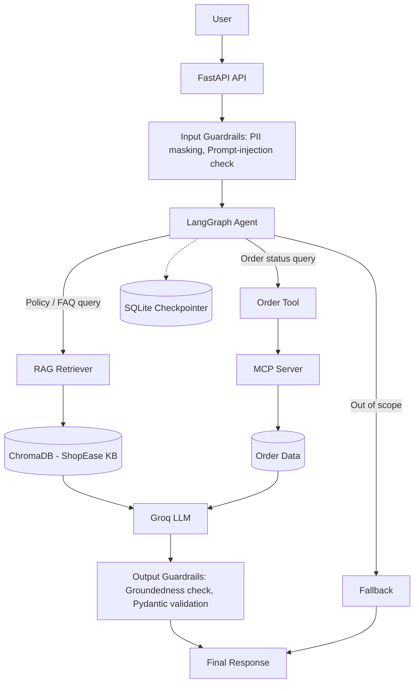

Section 1: Project Overview

# E-Commerce AI Customer Support Agent

An AI-powered customer support agent for an e-commerce platform called **ShopEase**.

The system uses **RAG, LangGraph, Groq LLM, MCP, persistent memory, guardrails, and resilience mechanisms** to answer customer questions, retrieve order information, and safely handle unsupported or malicious requests.

## Key Features

- Retrieval-Augmented Generation (RAG) using a ShopEase knowledge base
- Fixed-size and sentence-based document chunking
- Semantic search using sentence embeddings and ChromaDB
- Calibrated retrieval threshold
- LangGraph-based conditional agent routing
- Order status lookup with escalation scoring
- Persistent conversation memory using JSON
- Strict Pydantic response validation
- PII detection and masking
- Prompt injection detection and blocking
- Groundedness checking
- FastAPI REST endpoints
- Structured logging with trace IDs and execution timing
- MCP-based order tool
- SQLite checkpointing and failure recovery
- Exponential-backoff retries
- Per-node and global timeouts
- RAG evaluation and RAG Triad metrics

Section 2: Architecture


## System Architecture




## Demo

### Knowledge-base query (RAG)

**Request**
```json
POST /ask
{ "query": "What is the return policy?", "session_id": "demo" }
```

**Response** (trimmed)
```json
{
  "trace_id": "588b9c76-4814-47c2-9e7a-9904005841ae",
  "query": "What is the return policy?",
  "injection_detected": false,
  "intent": "rag",
  "retrieved_context": [
    {
      "source": "returns.md",
      "similarity": 0.61,
      "text": "A return request submitted after the 7-day return period may be rejected unless..."
    }
  ],
  "answer": "A return request submitted after the 7-day return period may be rejected unless an exception is approved by customer support..."
}
```

### Prompt injection blocked

![Prompt injection blocked]


## Technology Stack

| Component            | Technology            |
| -------------------- | --------------------- |
| Programming Language | Python                |
| LLM                  | Groq                  |
| Agent Framework      | LangGraph             |
| API                  | FastAPI               |
| Embeddings           | Sentence Transformers |
| Vector Database      | ChromaDB              |
| Tool Protocol        | MCP                   |
| Memory               | JSON                  |
| Checkpointing        | SQLite                |
| Validation           | Pydantic              |
| Retry Mechanism      | Tenacity              |
| Data Processing      | Pandas / NumPy        |

Section 3 — Dataset & RAG

## Dataset & RAG

### Order Dataset

The project uses a deterministic synthetic e-commerce order dataset containing **50 order records**.

Each order contains:

- Order ID
- Customer name
- Product name
- Product type
- Amount
- Order status
- Order date
- Customer contact

The dataset is generated using a fixed random seed so that results are reproducible.

### Knowledge Base

The ShopEase knowledge base contains **14 Markdown documents** covering topics such as:

- Returns
- Refunds
- Shipping
- Order cancellation
- Order tracking
- Payments
- Failed payments
- Cash on delivery
- Exchange
- Warranty
- Damaged products
- Delivery delays
- Privacy
- Customer support

### Document Chunking

Two chunking strategies are implemented and evaluated:

1. **Fixed-size chunking** — documents are divided into chunks based on character size with overlap.
2. **Sentence-based chunking** — documents are divided into groups of sentences.

### Embeddings and Retrieval

The project uses **Sentence Transformers (`all-MiniLM-L6-v2`)** to generate embeddings.

The embeddings are stored in **ChromaDB** using cosine similarity for semantic retrieval.

The system retrieves the top 3 relevant chunks for each query.

### Retrieval Threshold

A retrieval threshold of **0.3802** was selected using calibration queries.

- Lowest in-scope similarity: **0.5713**
- Highest out-of-scope similarity: **0.1892**
- Threshold: **0.3802**

Queries below this threshold are treated as unsupported by the knowledge base.

### Chunking Evaluation

| Strategy       | Precision | Recall |
| -------------- | --------: | -----: |
| Fixed-size     |    0.5200 | 1.0000 |
| Sentence-based |    0.5417 | 1.0000 |

**Decision:** Sentence-based chunking was selected because it achieved slightly higher precision while maintaining the same recall.


Section 4 — Agent & Guardrails

## Agent & Guardrails

### LangGraph Agent

The customer-support agent is implemented using **LangGraph** with conditional routing.

The main workflow includes:

- Memory loading
- PII guardrail
- Prompt injection detection
- Query classification
- Knowledge-base retrieval
- Order status tool
- Fallback handling
- Answer generation
- Response validation

The classifier routes queries into three main paths:

- **RAG** — for knowledge-base questions
- **Order** — for order-status queries
- **Unknown** — for unsupported questions

### Order Status and Escalation

The order tool returns:

- Order status
- Order amount
- Escalation score

The escalation score is calculated using status and order amount.

Higher-risk statuses and higher-value orders receive higher scores. Orders with a score of **0.6 or above** require escalation.

### Persistent Memory

Conversation history is stored in **JSON files** using a session ID.

This allows the agent to retain conversation history across separate program executions.

### Response Validation

Every generated response is validated using a **Pydantic schema** before being returned.

The schema contains fields such as:

- Answer
- Source
- Similarity
- Order ID
- Amount
- Escalation score
- Escalation status
- Groundedness

### Guardrails

The system implements three guardrails:

1. **PII Masking** — detects and masks email addresses and phone numbers.
2. **Prompt Injection Detection** — detects malicious instructions such as attempts to ignore system instructions or reveal the system prompt.
3. **Groundedness Check** — verifies that generated answers contain sufficient information supported by the retrieved knowledge-base context.

Detected prompt injection attempts are blocked instead of being processed normally.

Section 5 — API & Evaluation

## API & Evaluation

### FastAPI

The application exposes REST APIs using FastAPI.

#### `POST /ask`

Accepts a customer query and session ID, then returns the agent's validated response along with a trace ID.

#### `POST /add_document`

Allows a new knowledge-base document to be added to the ShopEase knowledge base.

### Structured Logging

Each API request generates a unique **trace ID**.

The logs record:

- Trace ID
- Masked query
- Masked answer
- Execution time

PII is masked before being written to logs.

### Evaluation Dataset

The system is evaluated using **15 test queries** covering the knowledge-base topics and edge cases.

The evaluation includes:

- Knowledge-base coverage
- Retrieval performance
- RAG Triad metrics
- Edge-case handling

### RAG Triad

The following metrics are calculated:

- **Context Relevance** — measures how relevant the retrieved context is to the query.
- **Groundedness** — measures whether the answer is supported by the retrieved context.
- **Answer Relevance** — measures whether the generated answer is relevant to the user's query.

Average scores are calculated across the evaluation queries and stored in:

`data/evaluation/rag_triad_results.csv`

Section 6 — Resilience

## Resilience

### MCP Tool Integration

The order-status functionality is exposed through an **MCP server**.

An MCP client can call the `check_order` tool to retrieve order information.

The MCP integration was tested with multiple order IDs to verify successful tool communication.

### SQLite Checkpointing

LangGraph uses **SQLite checkpointing** to persist workflow state.

If a workflow fails during execution, it can resume from the latest checkpoint instead of re-executing completed nodes.

This was demonstrated using a simulated node failure.

### Retry Mechanism

The system uses **Tenacity** with exponential backoff for temporary failures.

The retry configuration allows up to **3 attempts** with increasing wait times between attempts.

A simulated failure test demonstrates successful recovery.

### Timeouts

Timeout handling is implemented for long-running operations.

The system supports:

- **Per-node timeout** — prevents an individual operation from running indefinitely.
- **Global timeout** — limits the maximum execution time of the overall operation.

Timeout tests were performed using simulated slow operations.

Section 7 — Project Structure

## Project Structure

```text
ecommerce-ai-agent/
├── app/
│   ├── api/
│   │   └── routes.py
│   ├── agent/
│   │   ├── graph.py
│   │   ├── state.py
│   │   └── nodes.py
│   ├── rag/
│   │   ├── loader.py
│   │   ├── chunking.py
│   │   ├── embeddings.py
│   │   ├── retriever.py
│   │   └── pipeline.py
│   ├── tools/
│   │   ├── order_tool.py
│   │   ├── mcp_server.py
│   │   └── retry.py
│   ├── guardrails/
│   │   ├── pii.py
│   │   ├── injection.py
│   │   └── groundedness.py
│   ├── memory/
│   │   └── memory.py
│   ├── models/
│   │   └── schemas.py
│   ├── logging/
│   │   └── logger.py
│   ├── main.py
│   
│
├── data/
│   ├── orders/
│   ├── knowledge_base/
│   ├── vector_store/
│   └── evaluation/
│
├── eval/
│   └── rag_triad.py
│
├── scripts/
├── tests/
├── storage/
│   ├── memory/
│   └── checkpoints/
│
├── prompts/
├── README.md
├── architecture.md
├── DEMO_COMMANDS.md
├── requirements.txt
└── .gitignore
